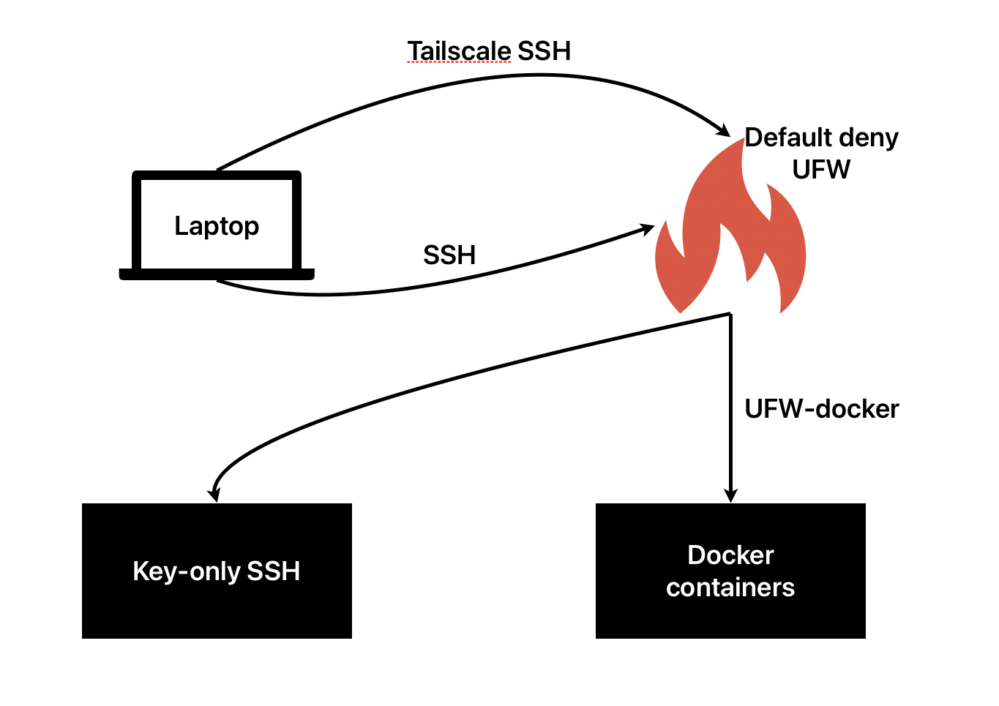

# homelab

TateDeb is my home server I built as an ongoing project to host cloud file storage, LLMs, claude code, and whatever else I may find it good for. It's a Debian 13 box running Docker hardened with UFW that I can reach from anywhere over Tailscale. Everything I set up is either scripted or written down so I can rebuild it from a blank drive.

## Why I built it

I wanted hands-on practice setting up and hardening a Linux server myself. The end goal is for it to handle backups for my photos/files, run open-source LLMs and/or a claude code server, and whatever else I might find it good for. For now the focus was on getting a solid and secure base layer established.

## Hardware

- It's running on my gaming PC (which I unfortunately don't have time to use), Debian has its own M.2 drive and I switch drives with BIOS profiles, so the two installs never share a drive or bootloader.
- Windows runs on my other SATA drive.
- Everything is managed over SSH from my laptop so there is no desktop environment.

## Stack

- Debian 13 (trixie)
- Docker Engine and Docker Compose from Docker's official apt repo
- UFW with ufw-docker
- Tailscale for remote access
- Bash scripts for the install steps

## Network Diagram



## Problems I ran into and fixed

### Docker skipping the firewall
Docker writes its own firewall rules, so any container port I published was open to my whole LAN even though UFW was set to deny. I fixed it with ufw-docker and limited it to only trust Docker's own subnets (172.16.0.0/12). To test it I ran an nginx container, confirmed curl from my laptop timed out, and saw the drops show up in the kernel log.

### Tailscale skipping the firewall
After setting up Tailscale I ran a throwaway web server on a port UFW should block, and it still loaded from my latop. Tailscale adds its own iptables chain with a rule that accepts everything on the tailscale0 interface before UFW sees it. Because of this I turned off Tailscale's firewall management and allowed only SSH and Tailscale's own UDP port in UFW. After that the port test timed out and containers were blocked over Tailscale.


### GRUB rescue after switching BIOS profiles
Switching BIOS profiles kept dropping me into grub rescue. I traced it to Kali's old bootloader sitting in the EFI fallback path from a previous install (same date and the file size as Kali's GRUB). I removed it, put Debian's bootloader in the fallback slot, and set GRUB updates to keep that copy current.

## Hardening

- SSH is key-only, with password and root login turned off
- UFW denies everything by default, only SSH is allowed (plus Tailscale's UDP port).
- Unattended upgrades for security patches.
- ufw-docker installs from a copy saved in this repo instead of downloading it fresh, so a rebuild uses the exact version I reviewed.
- Sleep is disabled so the server stays up.

## Scripts

Every script is safe to re-run and verifies its work at the end.

```
scripts/
  install-docker.sh     # install Docker Engine and Compose
  docker-ufw.sh         # make Docker respect UFW
  install-tailscale.sh  # install Tailscale
  tailscale-ufw.sh      # allow ssh over Tailscale and make it respect UFW
  lib/
    common.sh           # shared helper functions and checks
  vendor/
    ufw-docker          # reviewed copy of ufw-docker
```

## Docs

- [Rebuild guide](docs/rebuild.md): step by step, and each section ends with a check
- [Setup log](docs/setup-log.md): what I did, the decisions I made, and how I tested them

## Hypothetical Roadmap

- Immich for photo backups
- Restic or Borg for backing up the server
- Hugging face LLM
- Claude code
- Caddy reverse proxy.